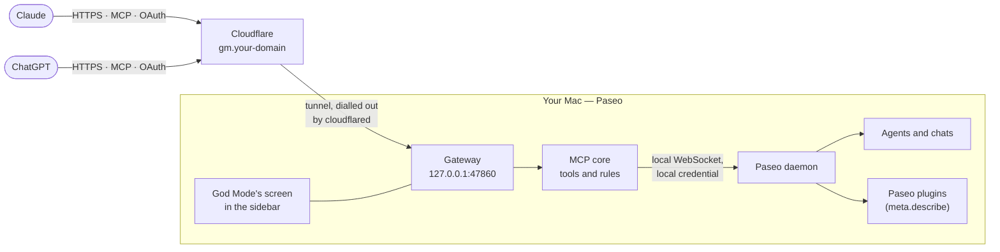
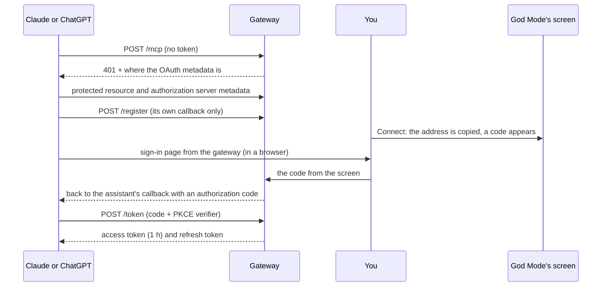
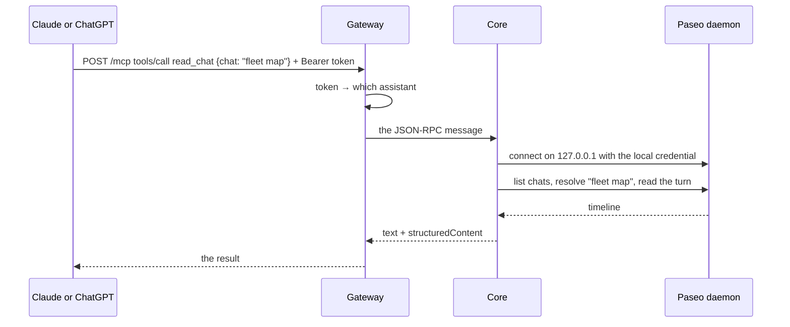
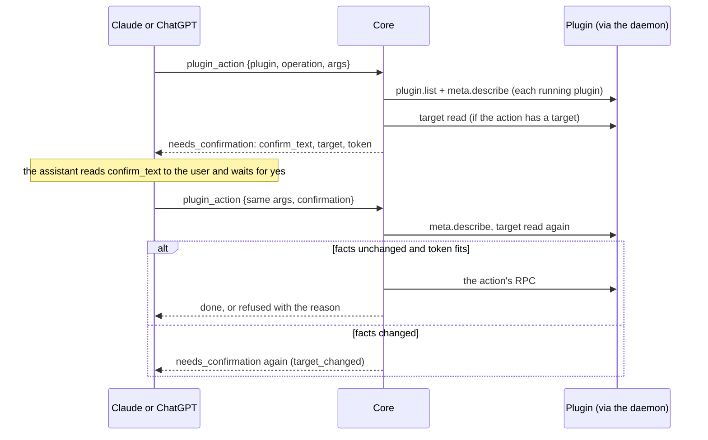

# Architecture

God Mode is a Paseo plugin that is also an MCP server. Its server half runs a small **gateway** on the
Mac; the user's own **Cloudflare tunnel** gives that gateway a public address; **Claude** and
**ChatGPT** connect to the address over OAuth; the **core** behind the gateway turns their tool calls
into requests to the Paseo daemon on the same Mac.



## Components

| Part | Where | What it does |
| --- | --- | --- |
| Screen | `client/home.tsx`, `index.client.tsx` | The sidebar row and the screen: the address, Connect Claude, Connect ChatGPT, the voice button switch. |
| Plugin server | `index.server.ts` | Starts the gateway and the tunnel with the plugin and answers the screen's RPCs. |
| Gateway | `server/gateway/http.ts`, `service.ts` | HTTP on 127.0.0.1:47860: OAuth discovery and endpoints, the sign-in page, `/mcp`. |
| OAuth | `server/gateway/oauth.ts` | Registrations, the sign-in code, tokens (stored as hashes), refresh rotation, connections. |
| Call log | `server/gateway/calllog.ts` | One JSON line per tool call in `~/.paseo/god-mode/calls.jsonl`, read by `get_logs`. |
| Tunnel | `server/tunnel/cloudflared.ts` | Installs `cloudflared`, signs in, creates the tunnel and its hostname, keeps it running. |
| Tools and rules | `server/core/mcp.mjs` | Instructions, tool metadata, dispatch, deadlines, logging hooks. |
| Paseo operations | `server/core/paseo.mjs`, `local.mjs` | One local connection per call: chats, turns, activity, images, writes, models, slash commands, plugins. |
| Plugin contract | `server/core/capabilities.mjs` | Checks `meta.describe` answers, resolves names, checks arguments, trims answers, signs confirmations. |
| Slash commands | `server/core/slash.mjs` | Which of a chat's commands run, at what risk and how. |
| Models | `server/core/models.mjs` | Paseo's runtime catalog: matching what the user named, defaults that fit, what `list_models` shows. |
| Text | `server/core/text.mjs` | Name matching and the short text the assistant reads or speaks. |
| Images widget | `server/core/widget.mjs` | The MCP Apps view `show_images` uses. |
| Voice button | `client/voice-button*.tsx`, `server/voice-button/` | The optional button that opens ChatGPT's voice chat. |
| Contracts | `shared/` | The RPC contracts between the screen and the plugin server, and the version. |

The core is plain JavaScript without server APIs, so it runs in the plugin and under `node --test`.

## Connecting an assistant



- Registration is accepted only with Claude's (`claude.ai`, `claude.com`) or ChatGPT's (`chatgpt.com`,
  `chat.openai.com`) callbacks, and the callback names the connection: Claude or ChatGPT.
- The code is 8 digits, appears when the user presses Connect, works once, for five minutes and five
  tries. Without a code nobody can sign in.
- The assistant refreshes its token by itself; a refresh token is spent on use, and one that comes
  back revokes everything issued from that sign-in.

## One tool call



- Every call connects, works and closes; a read takes tens of milliseconds.
- A call has 30 seconds in all. Writes never wait for the agent: they return as soon as the message
  arrived, and `read_chat` tells what the agent said.
- The daemon's address comes from `~/.paseo/paseo.pid` (or `PASEO_LISTEN`), its credential from
  `~/.paseo/local-credential`; both are read on every call.

## A plugin action that asks first



Details: [plugin-tools.md](plugin-tools.md); guarantees: [security.md](security.md).

## The tunnel

The Address button runs the whole setup from the plugin server:

1. finds `cloudflared` (Homebrew's, or a copy in `~/.paseo/god-mode/bin/`) and installs it if missing;
2. starts `cloudflared tunnel login` with no browser on the Mac and opens its link on the device where
   the button was pressed;
3. when Cloudflare hands over the sign-in key, creates the tunnel `god-mode`, routes `gm.<domain>` to
   it and writes `~/.paseo/god-mode/tunnel/config.yml`, which publishes that one hostname to
   127.0.0.1:47860 and nothing else;
4. deletes the sign-in key (`~/.cloudflared/cert.pem`) and runs `cloudflared` for as long as the
   plugin runs, restarting it with a growing pause when it stops.

## Where the model's guidance lives

| Layer | Content |
| --- | --- |
| Server instructions | The domain, which tool for which request, the write rules, the language, dictation hints. ChatGPT reads them up front; Claude gets them only with a tool result, as advice. |
| Tool and argument descriptions | "Use this when…", what each argument takes, read or write, the rules that matter for that tool. Both assistants read these before calling. |
| Lines in results | The next step: ask which chat, still working, nothing was sent. |
| Plugin descriptions | Each plugin's own titles, descriptions and `confirmText`, through `plugin_read` and `plugin_action`. |

ChatGPT gives its model a result's text and its structured data; Claude's model sees the text. The
text for the model is English; the assistant answers in the user's language.

## Repository layout

```text
index.server.ts, index.client.tsx   the plugin's entry points
client/                             the screen and the voice button
server/gateway/                     HTTP, OAuth, the call log, the service that starts them
server/tunnel/                      cloudflared: install, sign-in, create, run
server/core/                        the MCP core: tools, rules, Paseo operations (plain JS, node --test)
server/voice-button/                launching ChatGPT's voice chat on a Mac
shared/                             RPC contracts and the version
eval/                               the tool-selection eval
docs/                               this documentation
```

Paseo builds a plugin's modules only from `client/`, `server/` and `shared/`.
